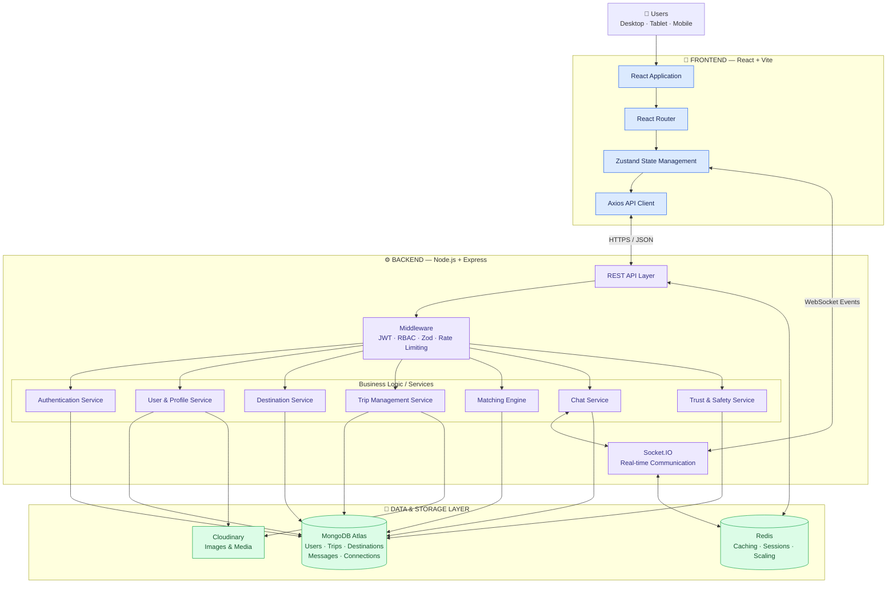
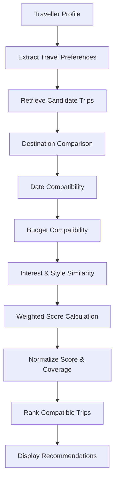

# 🌍 TripBuddy – Find Your Travel Companion

### Travel Together. Explore More. Create Memories.

**TripBuddy** is a full-stack travel companion platform designed to connect people who want to explore the world but don't always have someone to travel with.

The platform enables travellers to discover destinations, create and explore trips, connect with like-minded people, and find compatible travel companions based on shared interests, budgets, travel preferences and compatibility.

Built using the **MERN Stack**, TripBuddy combines modern web technologies, intelligent preference-based matching, real-time communication architecture and user-centric travel discovery to make travelling more social, accessible and collaborative.

---

## 📌 Table of Contents

- [About the Project](#-about-the-project)
- [Key Features](#-key-features)
- [System Architecture](#-system-architecture)
- [Technology Stack](#-technology-stack)
- [Smart Matching Algorithm](#-smart-traveller-matching-algorithm)
- [Project Structure](#-project-structure)
- [Getting Started](#-getting-started)
- [Environment Variables](#-environment-variables)
- [API Overview](#-api-overview)
- [Security](#-security)
- [Testing](#-testing)
- [Future Roadmap](#-future-roadmap)
- [Contributing](#-contributing)
- [Developer](#-developer)

---

## 🎯 About the Project

Travelling alone can sometimes be difficult, especially when people want to explore new destinations but don't have compatible travel companions.

TripBuddy addresses this problem by providing a centralized platform where travellers can:

- Discover destinations and travel opportunities.
- Create and publish travel plans.
- Find people with similar travel interests.
- Compare travel preferences and compatibility.
- Build connections with other travellers.
- Coordinate travel plans and communicate.

### 💡 Our Vision

To build a trusted travel community where discovering places and finding the right travel companions becomes simple, social and accessible.

---

## ✨ Key Features

### 👤 1. Authentication & User Identity
- User registration and login.
- JWT-based authentication.
- Protected routes and user sessions.
- Secure password handling.
- Verification foundations.
- Public and private user profiles.

### 🧑‍🤝‍🧑 2. Traveller Profiles & Travel Identity
- Customizable traveller profiles.
- Profile pictures and cover images.
- Personal bio and location.
- Travel preferences and interests.
- Preferred budget and group size.
- Accommodation and transportation preferences.
- Travel style and preferred destinations.
- Dynamic profile completeness tracking.

### 🗺️ 3. Destination Discovery
- Explore travel destinations.
- Destination-based search and filtering.
- Discover places based on interests.
- Budget-oriented destination discovery.
- Destination categorization and information.

### ✈️ 4. Trip Creation & Management
- Create and manage travel plans.
- Save trips as drafts.
- Publish trips for other travellers.
- Update trip information.
- Manage trip visibility and lifecycle.
- Upload trip images.
- Explore trips created by other users.

### 🔍 5. Smart Traveller Matching

TripBuddy uses a deterministic, preference-based compatibility engine to identify travellers and trips that align with each other's preferences.

Matching parameters:

| Parameter | Weight |
|---|---:|
| Destination compatibility | 25% |
| Travel date compatibility | 20% |
| Budget compatibility | 15% |
| Shared interests | 15% |
| Travel style | 10% |
| Preferred activities | 5% |
| Group size | 5% |
| Other preferences | 5% |

Matching techniques:
- Jaccard similarity for preference comparison.
- Budget range overlap.
- Travel date compatibility.
- Weighted compatibility scoring.
- Score coverage and missing-data handling.
- Caching for repeated matching requests.

*Compatibility scores represent preference similarity, not a guaranteed prediction of travel success.*

### 💬 6. Real-Time Communication Architecture
- Socket.IO-based communication architecture.
- Authenticated socket connections.
- Conversation authorization.
- Trip-based and direct conversation foundations.
- REST API and real-time event integration.

### 🛡️ 7. Trust, Safety & Security
- Protected API endpoints.
- Role-based authorization foundations.
- User blocking and reporting workflows.
- Verification mechanisms.
- Private profile data handling.
- Secure file upload foundations.
- Request validation and rate limiting.

---

## 🏗️ System Architecture

TripBuddy follows a modular client-server architecture that separates the frontend, backend business logic, real-time communication and data storage.

### Interactive Architecture Diagram

The following Mermaid diagram is rendered directly by GitHub. You can inspect the different system layers and their connections.



### Architecture Layers Explained

| Layer | Responsibility |
|---|---|
| Client Layer | User interaction across desktop, tablet and mobile |
| Frontend Layer | React UI, routing, state management and API communication |
| API Layer | Handles HTTP requests and responses |
| Middleware Layer | Authentication, authorization, validation and security |
| Service Layer | Core business logic and application functionality |
| Real-time Layer | Socket.IO-based event communication |
| Database Layer | Persistent storage using MongoDB |
| Cache Layer | Shared caching and real-time scaling support |
| Media Layer | Image and file storage using Cloudinary |

*Redis is shown as a production architecture component; configure it only when the corresponding application functionality is implemented.*

---

## 🛠️ Technology Stack

### Frontend
| Technology | Purpose |
|---|---|
| React.js | User interface |
| Vite | Development and build tooling |
| Tailwind CSS | Styling |
| Zustand | State management |
| React Router | Client-side navigation |
| Axios | API communication |
| React Hook Form | Form handling |
| Zod | Schema validation |
| Lucide React | Icons |

### Backend
| Technology | Purpose |
|---|---|
| Node.js | JavaScript runtime |
| Express.js | Backend framework |
| MongoDB | Database |
| Mongoose | Database modeling |
| JWT | Authentication |
| bcrypt | Password hashing |
| Socket.IO | Real-time communication |
| Zod | Request validation |

### Storage & Infrastructure
| Technology | Purpose |
|---|---|
| MongoDB Atlas | Cloud database |
| Cloudinary | Image and media storage |
| Redis | Caching and distributed communication support |
| Git & GitHub | Version control |
| ESLint | Code quality |
| Prettier | Code formatting |
| Thunder Client | API testing |

---

## 🧠 Smart Traveller Matching Algorithm

One of TripBuddy's core engineering components is its deterministic compatibility engine.

Instead of relying entirely on generative AI, TripBuddy uses structured traveller preferences and weighted similarity calculations.

### Matching Workflow



### Scoring Dimensions

- Destination compatibility: 25%
- Travel dates: 20%
- Budget: 15%
- Interests: 15%
- Travel style: 10%
- Activities: 5%
- Group size: 5%
- Other preferences: 5%

The resulting compatibility score helps travellers identify trips and people that align with their expectations.

---

## 📁 Project Structure

```text
Trip-Buddy/
│
├── client/
│   ├── public/
│   └── src/
│       ├── assets/
│       ├── components/
│       │   ├── profile/
│       │   └── ...
│       ├── hooks/
│       ├── pages/
│       │   └── profile/
│       ├── services/
│       ├── store/
│       ├── App.jsx
│       └── main.jsx
│
├── server/
│   ├── src/
│   │   ├── config/
│   │   ├── controllers/
│   │   ├── middleware/
│   │   ├── models/
│   │   ├── routes/
│   │   ├── services/
│   │   ├── validators/
│   │   └── utils/
│   │
│   ├── scripts/
│   └── tests/
│
├── docs/
│   ├── api/
│   └── deployment/
│
├── package.json
└── README.md
```

*This is a representative logical structure. Keep it synchronized with the actual repository.*

---

## 🚀 Getting Started

Follow these instructions to run TripBuddy locally.

### Prerequisites

Install the following:

- Node.js (LTS recommended)
- npm
- Git
- MongoDB Atlas account or local MongoDB
- Cloudinary account for media uploads

### 1. Clone the Repository

```bash
git clone https://github.com/ashutoshdeepu256-coder/Trip-Buddy.git

cd Trip-Buddy
```

### 2. Install Dependencies

```bash
npm install
```

For an npm workspace-based project, install dependencies from the root directory.

### 3. Configure Environment Variables

Create the required `.env` files using the provided example configurations.

### 4. Start the Backend

```bash
npm run dev --workspace=server
```

Backend:

`http://localhost:5000`

### 5. Start the Frontend

Open a separate terminal:

```bash
npm run dev --workspace=client
```

Frontend:

`http://localhost:5173`

### 6. Build for Production

```bash
npm run build --workspace=client
```

---

## 🔐 Environment Variables

Example backend configuration:

```env
NODE_ENV=development
PORT=5000

MONGODB_URI=your_mongodb_connection_string

JWT_SECRET=your_secure_jwt_secret

CLIENT_URL=http://localhost:5173

CLOUDINARY_URL=your_cloudinary_configuration

REDIS_URL=your_redis_connection_string
```

Example frontend configuration:

```env
VITE_API_URL=http://localhost:5000/api/v1
```

**Important:**
- Use strong, unique secrets.
- Never commit `.env` files.
- Never expose backend secrets through frontend variables.
- Configure only the environment variables required by the implemented features.
- Use HTTPS and production-specific configuration when deploying.

---

## 🔌 API Overview

TripBuddy uses REST APIs for application operations.

The following table describes the documented API areas.

| Module | Example Endpoint | Method |
|---|---|---|
| User Profile | `/api/v1/users/me` | GET |
| Update Profile | `/api/v1/users/me` | PUT |
| Travel Preferences | `/api/v1/users/me/travel-profile` | PUT |
| Profile Completeness | `/api/v1/users/me/completeness` | GET |
| Public Profile | `/api/v1/users/:userId` | GET |
| Traveller Statistics | `/api/v1/users/:userId/stats` | GET |
| Profile Image | `/api/v1/users/me/profile-image` | POST |
| Cover Image | `/api/v1/users/me/cover-image` | POST |

Additional API modules include authentication, destinations, trips, discovery, matching, chat and safety.

For complete request/response specifications, see:

`docs/api/`

---

## 🛡️ Security

Security is an important part of TripBuddy's architecture.

The application incorporates or is designed around:

- JWT-based authentication.
- Password hashing.
- Protected API endpoints.
- Role-based authorization.
- Zod-based request validation.
- Secure HTTP headers.
- Rate limiting.
- Controlled file uploads.
- Public/private profile separation.
- User blocking and reporting mechanisms.

Production deployment should additionally enforce secure cookies, CSRF protection where applicable, strict CORS configuration, secret management, audit logging and database backup procedures.

---

## 🧪 Testing & Code Quality

TripBuddy includes separate frontend and backend development workflows.

Example commands:

```bash
# Backend tests
npm run test:server

# Frontend tests
npm run test:client

# Backend lint
npm run lint --workspace=server

# Frontend lint
npm run lint --workspace=client

# Production build
npm run build --workspace=client

# Dependency security audit
npm audit
```

Run only the scripts available in the current package configuration. Database integration tests should use a dedicated disposable test database.

---

## 🔮 Future Roadmap

| Feature | Status |
|---|---|
| Authentication & Identity | Implemented foundation |
| User Profile Management | Implemented |
| Travel Preferences | Implemented |
| Destination Discovery | Implemented foundation |
| Trip Creation & Management | Implemented foundation |
| Trip Discovery | Implemented foundation |
| Compatibility Matching | Implemented foundation |
| Real-time Chat | Architecture and integration |
| Connection & Membership Lifecycle | Further integration |
| Trust & Safety | Further verification |
| Automated E2E Testing | Planned |
| Production Monitoring | Planned |
| Distributed Scaling | Planned |

### Future Enhancements

- AI-powered personalized travel recommendations.
- Interactive maps and route planning.
- Advanced traveller recommendations.
- Integrated booking services.
- Expense splitting and shared trip budgets.
- Emergency assistance features.
- Advanced identity verification.
- Mobile application.
- Multilingual support.
- Analytics-driven travel insights.

---

## 🤝 Contributing

Contributions, suggestions and feedback are welcome.

1. Fork the repository.
2. Create a feature branch.

```bash
git checkout -b feature/your-feature-name
```

3. Commit your changes.

```bash
git commit -m "feat: add your feature"
```

4. Push your branch.

```bash
git push origin feature/your-feature-name
```

5. Open a Pull Request.

Please follow the project's coding conventions and include appropriate tests for new functionality.

---

## 👨‍💻 Developer

**Ashutosh Deepu**

Full Stack Developer | MERN Stack | Software Development

- GitHub: [@ashutoshdeepu256-coder](https://github.com/ashutoshdeepu256-coder)
- Project: [TripBuddy Repository](https://github.com/ashutoshdeepu256-coder/Trip-Buddy)

---

## ⭐ Support the Project

If you find TripBuddy interesting, consider giving this repository a ⭐.

Your feedback, suggestions and contributions are always welcome!

---

### 🌍 TripBuddy

**Because every great journey deserves great companions.** ✈️
